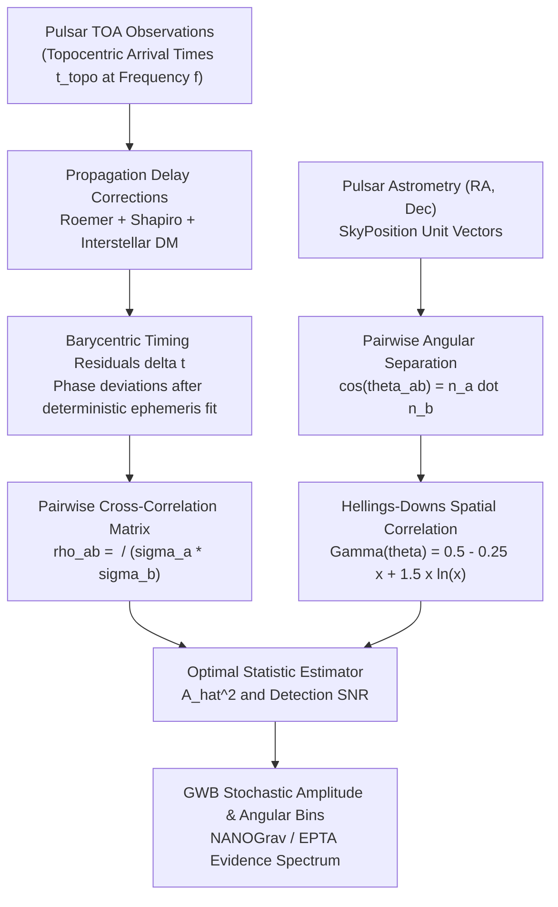

# PulsarTiming

[](https://github.com/ZengLLQ/pulsar-timing/actions/workflows/ci.yml)
[](LICENSE)
[](https://www.python.org)

**PulsarTiming** is a high-precision astrometric timing and stochastic gravitational wave background (GWB) cross-correlation engine implementing the specifications of modern Pulsar Timing Array (PTA) collaborations (NANOGrav, EPTA, PPTA, InPTA).

It provides complete implementations of:
- **Astrometric Coordinate Transformations**: Right Ascension / Declination unit sphere kinematics and pairwise angular separations.
- **Relativistic Propagation Delays**: Roemer geometric delays to the Solar System Barycenter (SSB), general-relativistic Solar Shapiro delays, and cold-plasma interstellar dispersion measure ($\text{DM}$) corrections.
- **Hellings and Downs (1983) Angular Correlation**: Quadrupolar spatial signature $\Gamma(\theta)$ of isotropic stochastic gravitational radiation.
- **Optimal Statistic Estimator ($\hat{A}^2$)**: Frequency-domain weighted cross-correlation estimator and signal-to-noise ratio ($\text{SNR}$) calculation for nanohertz gravitational waves from supermassive black hole binary (SMBHB) mergers.

---

## Physical and Mathematical Formulation

### 1. Barycentric Coordinate Arrival Time Conversion

Topocentric pulse times-of-arrival (TOA) $t_{\text{topo}}$ recorded at terrestrial radio telescopes are transferred to the Solar System Barycenter (SSB) coordinate time $t_{\text{SSB}}$:

$$t_{\text{SSB}} = t_{\text{topo}} + \Delta_{\text{Roemer}} + \Delta_{\text{Shapiro}} - \Delta_{\text{DM}}$$

#### Roemer Geometric Delay
$$\Delta_{\text{Roemer}} = -\frac{\mathbf{r}_{\text{obs}} \cdot \hat{\mathbf{n}}}{c}$$
where $\mathbf{r}_{\text{obs}}$ is the position vector of the observatory relative to the SSB, and $\hat{\mathbf{n}}$ is the unit vector pointing toward the pulsar.

#### Shapiro Gravitational Curvature Delay
$$\Delta_{\text{Shapiro}} = -\frac{2 G M_\odot}{c^3} \ln\left(1 - \hat{\mathbf{s}} \cdot \hat{\mathbf{n}}\right)$$
where $\hat{\mathbf{s}} = \mathbf{r}_{\text{obs}} / \|\mathbf{r}_{\text{obs}}\|$ points from the Sun to the Earth.

#### Interstellar Cold-Plasma Dispersion
$$\Delta_{\text{DM}} = \mathcal{D} \times \frac{\text{DM}}{f^2} \quad \text{with} \quad \mathcal{D} = \frac{e^2}{2\pi m_e c} \approx 4.148808 \times 10^3 \text{ MHz}^2 \text{ pc}^{-1} \text{ cm}^3 \text{ s}$$

---

### 2. Hellings and Downs Correlation Curve

For an isotropic stochastic background of unpolarized transverse-traceless gravitational waves, the spatial cross-correlation between timing residuals of pulsars $a$ and $b$ separated by angle $\theta_{ab}$ is given by:

$$\Gamma(\theta_{ab}) = \frac{1}{2} - \frac{1}{4} x + \frac{3}{2} x \ln(x) \quad \text{where} \quad x = \frac{1 - \cos\theta_{ab}}{2} = \sin^2\left(\frac{\theta_{ab}}{2}\right)$$

Boundary values:
- $\Gamma(0) = \frac{1}{2}$ (collinear limit)
- $\Gamma(90^\circ) = \frac{3}{8} - \frac{3}{4}\ln 2 \approx -0.14488$ (minimum quadrupolar dip)
- $\Gamma(180^\circ) = \frac{1}{4} = 0.25$ (antipodal)

---

### 3. Optimal Statistic ($\hat{A}^2$) and Signal-to-Noise Ratio

Given pairwise cross-correlations $\rho_{ab}$ with measurement variances $\sigma_{ab}^2$:

$$\hat{A}^2 = \frac{\sum_{a < b} \frac{\rho_{ab} \Gamma_{ab}}{\sigma_{ab}^2}}{\sum_{a < b} \frac{\Gamma_{ab}^2}{\sigma_{ab}^2}}$$

$$\text{SNR} = \frac{\hat{A}^2}{\sigma_0} = \frac{\sum_{a < b} \frac{\rho_{ab} \Gamma_{ab}}{\sigma_{ab}^2}}{\sqrt{\sum_{a < b} \frac{\Gamma_{ab}^2}{\sigma_{ab}^2}}}$$

---

## Architectural Flowchart



---

## Quickstart

```python
import numpy as np
from pulsar_timing import SkyPosition, hellings_downs_correlation, OptimalStatistic

# 1. Compute Hellings-Downs correlation across separation angles
thetas = np.radians([0.0, 45.0, 90.0, 135.0, 180.0])
gammas = hellings_downs_correlation(thetas)
for th_deg, g in zip([0, 45, 90, 135, 180], gammas):
    print(f"Angle {th_deg:3d} deg -> Hellings-Downs Gamma: {g:+.4f}")

# 2. Optimal Statistic evaluation
thetas_pairs = np.random.uniform(0.1, np.pi - 0.1, 50)
rhos = 2.5 * hellings_downs_correlation(thetas_pairs) + np.random.normal(0, 0.1, 50)
sigmas = np.full(50, 0.1)

opt = OptimalStatistic(thetas_pairs, rhos, sigmas)
a2, err, snr = opt.compute_amplitude_and_snr()
print(f"Recovered A^2: {a2:.3f} +/- {err:.3f} (SNR: {snr:.1f} sigma)")
```

---

## Testing

```bash
pytest -v
```

---

## License

MIT License. Copyright (c) 2026 ZengLLQ.
